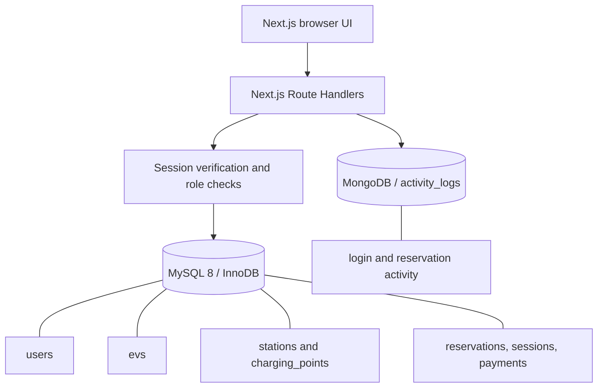

# System Architecture

## Overview

The application uses Next.js App Router for the browser interface and server-side Route Handlers. MySQL stores structured operational records. MongoDB stores flexible activity events.

## Responsibilities of each database

**MySQL** is the source of truth for users, EVs, charging stations, charging points, tariff plans, reservations, charging sessions and payments. These records have stable structure, relationships, foreign keys and transaction requirements.

**MongoDB** stores append-oriented activity documents in the `activity_logs` collection. Each document records an action, user, affected entity, timestamp and optional metadata. Activity documents are not used as the source of truth for bookings or payments.

## Authentication

1. Registration validates input, hashes the password with bcrypt and creates a customer account in MySQL.
2. Login verifies the password hash and creates a signed seven-day session.
3. The session is stored in an HttpOnly cookie; the Secure flag is enabled in production.
4. Protected Route Handlers verify the session on the server. Customer data operations are scoped to the authenticated user.
5. Activity-log retrieval returns a customer's own events. An authenticated admin can retrieve the application-wide audit stream.

The project includes customer and admin roles. The admin station-management screen is currently a prototype using local demo state; protected MySQL station/charging-point CRUD APIs are still outstanding.

## Reservation and payment transaction

The reservation API validates the requested time range, locks the selected charging-point row, verifies point status, tariff-to-station association and EV ownership, then rejects overlapping active reservations.

The API inserts the reservation and a `Pending` payment row in the same MySQL transaction. The payment amount is initialized to zero because the project does not process real payments; a simulated charging session can finalize the amount later. A failure before commit rolls back both inserts.

After the MySQL transaction commits, the API attempts to write a MongoDB activity event. MongoDB logging is best-effort and cannot undo a successful MySQL booking.

## Activity-log retrieval

- Successful login events are written as `auth.login`.
- Reservation creation and cancellation are written as `reservation.created` and `reservation.cancelled`.
- MongoDB indexes support chronological retrieval, user-scoped retrieval and action-based aggregation.
- The Activity screen calls `GET /api/activity-logs`; customer results are filtered to the signed-in user and administrators can inspect all events.

## Configuration

The application reads database and session configuration from environment variables. Do not hard-code credentials or commit `.env.local`. The required variable names are documented in `.env.example` and the repository README.

## Current limitations

- Admin station/charging-point CRUD is not yet connected to MySQL.
- Payments are simulated; there is no payment gateway.
- Charging sessions are demonstration records; there is no physical charger integration.
- Activity events currently cover login and reservation create/cancel; station-management events can be added when admin APIs are implemented.
